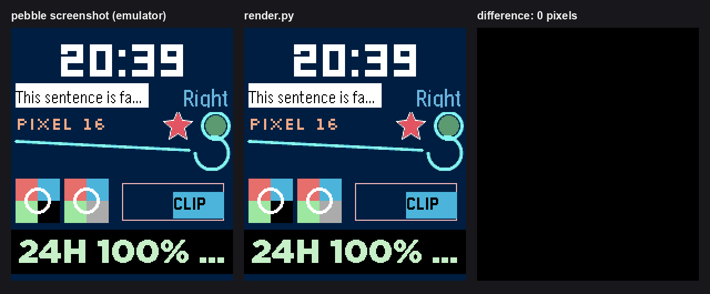

# pebble-render

Pixel-exact Pebble Time 2 (emery) screenshots on your computer, without the emulator.

`render.py` compiles the real PebbleOS graphics, font, window and layer code for your
machine, runs your watchface's own C code against it, and writes the same PNG
`pebble screenshot` would, pixel for pixel. A render takes about half a second, any
number can run in parallel, and you choose the scene: time, time zone, battery, phone
connection, steps, heart rate, even an incoming AppMessage.



## Why

Iterating on a watchface with the emulator means build, install, wait, screenshot after
every change, one app at a time. The emulator also hangs now and then when you switch
between apps ("X is not responding").

Measured on an M3 Pro Mac with a production watchface
(`tests/benchmark.py`, median of 5):

| One iteration | Time |
|---|---|
| Emulator: `pebble build`, install, settle, screenshot (warm) | 4.9 s |
| Emulator: the same, starting with the emulator stopped | 6.4 s |
| render.py after a code change (no `pebble build` needed) | 0.52 s |
| render.py when only the scene changes (`--time`, `--battery`...) | 0.07 s |
| render.py, ten different scenes in parallel (total) | 0.13 s |

That's about 9x faster per code change, 70x for scene changes, and nearly 400x for a
batch of ten scenes, which the emulator can only do one after another.

Use the emulator as the final check, and for what it does that this doesn't: real
animations, buttons, logs and other Pebble models.

## Accuracy

Every comparison below is a full-screen pixel diff against `pebble screenshot` from the
SDK's emery emulator, rendered at the same moment. All of them differ by zero pixels:

- `examples/kitchen-sink`: system fonts (Gothic, Bitham, LECO, Roboto), text alignment and
  ellipsis, a custom TTF, a PNG in plain and `GCompOpSet` bitmap layers, anti-aliased
  paths, lines, circles and arcs, nested layers with clipping and scrolled bounds
- the [pebble-watchface skill](https://github.com/coredevices/pebble-watchface-agent-skill)'s
  static and weather templates, and its Lightsaber Duel sample (including a star field
  drawn from `rand()` after `srand(time(NULL))`)
- a published production watchface with custom fonts, PDC icons, health and battery
- 45 renders of earlier watchface designs, through the lab mode described below

Check your own watchface with `python3 tests/parity.py path/to/project`. It needs the
emulator, and handles the app-switch hang by installing every project under one test UUID.

## Requirements

- macOS. It's developed and tested on Apple Silicon. Linux should work, but hasn't been
  tested.
- The [Pebble SDK](https://developer.repebble.com/sdk/) with its emery emulator. The fonts
  come from it.
- `clang`, `git`, and Python 3 with Pillow (`pip install Pillow`).
- About 500 MB of disk for the PebbleOS checkout.

## Setup

```sh
git clone https://github.com/LiamCordelle/pebble-render
cd pebble-render
sh setup.sh
```

`setup.sh` does three things:
1. Fetches PebbleOS at the tag of the firmware inside your SDK's emulator (`v4.33.2` for
   SDK 4.33.1), plus the FreeRTOS headers and TinyMT.
2. Applies the patches in `hostgfx/patches`.
3. Extracts the system fonts and resources from your SDK's emulator image.

Everything stays in this directory. Nothing is installed system-wide.

The first render afterwards also compiles the firmware code, once. On an M3 Pro, setup took
10 seconds and that first render about a second.

If you upgrade the SDK and its emulator firmware changes, `render.py` warns you. Re-run
setup with the new tag, for example `PEBBLEOS_TAG=v4.34.0 sh setup.sh`. Set `PEBBLE_SDK`
if your SDK isn't in the default location.

## Usage

```sh
cd my-watchface
pebble build                                      # once, and after resource changes
python3 ~/pebble-render/render.py . shot.png      # writes shot.png and shot_3x.png
```

Fonts, images and `RESOURCE_ID_*` come from your last `pebble build`, so rebuild after
changing resources. Code changes don't need a rebuild. The project must include `emery`
in `targetPlatforms`.

```sh
render.py . night.png --time 23:41 --12h --battery 9 --no-phone
render.py . weather.png --message TEMPERATURE=14 --message CONDITIONS=Cloudy
render.py . nz.png --tz Pacific/Auckland --date 2026-12-25
render.py . walk.png --steps 8342 --hr 112
render.py . animated.png --run-ms 1500     # app timers run for 1.5 s first
```

| Option | Default | Effect |
|---|---|---|
| `--time HH:MM[:SS]` | `10:09` | the time on the watch |
| `--date YYYY-MM-DD` | `2026-10-17` | the date |
| `--tz ZONE` | `UTC` | the watch's time zone (IANA name), for faces that show UTC or other zones |
| `--12h` | 24-hour | `clock_is_24h_style()` returns false |
| `--battery N` | `80` | `battery_state_service_peek()` charge |
| `--charging` | | charging and plugged in |
| `--no-phone` | connected | the phone is disconnected |
| `--steps N` | `0` | `health_service_sum_today(HealthMetricStepCount)` |
| `--hr N` | `0` | `health_service_peek_current_value(HealthMetricHeartRateBPM)` |
| `--run-ms N` | `0` | let app timers run for N ms of simulated time before the frame |
| `--no-tick` | | don't call the tick handler at start |
| `--message KEY=VALUE` | | deliver an AppMessage at start; `KEY` is a `messageKeys` name or a number; repeatable |
| `--scale N` | `3` | also write `OUT_<N>x.png`, a nearest-neighbour upscale (`1` to skip) |
| `--no-correction` | | skip the LCD colour correction `pebble screenshot` applies |
| `--raw FILE` | | also write the raw 8-bit framebuffer |
| `-v` | | print firmware log lines |

`APP_LOG` output always goes to stderr.

## What it runs

**Your app's real code.** `main()` runs, `init()` builds the windows and layers, and the
frame is drawn by the firmware's own `window_render`.

**Then, once, before the frame:**
1. app focus
2. the first tick, as the watch delivers at the next minute boundary
3. the `--message`, if any
4. `--run-ms` of app timers on a simulated clock

**Drawing (the firmware's own code):**
- `graphics_*`, `GPath`, PDC draw commands, bitmaps and PNGs, `GBitmapSequence`
- system and custom fonts
- `Layer` trees with clipping, `TextLayer`, `BitmapLayer`, `RotBitmapLayer`, `Window`

**Services (deterministic stand-ins):**
- time and time zone, clock style, battery, phone connection, health (steps and heart rate)
- persistent storage: in memory, empty at start like a fresh install
- AppMessage: outgoing messages are accepted and dropped; incoming ones come from
  `--message`
- accelerometer, compass, touch, vibes and backlight calls are accepted and ignored

**Not supported yet.** The render stops with a message naming the call:
- the `Animation` and `PropertyAnimation` framework
- `MenuLayer`, `ScrollLayer`, `ActionBarLayer`, `StatusBarLayer`
- `AppSync`, dictation, wakeup, workers, data logging, app glances

Other limits:
- **Platform:** emery (Pebble Time 2) only. Use the emulator for other models.
- **Compiler:** your C is compiled by clang, so GCC-only extensions, such as nested
  functions, won't build.
- **Randomness:** faces that draw random elements on every redraw depend on how many frames
  have run, so they won't match a particular emulator frame. The random-number generator
  itself is the firmware's.

## How it works

`hostgfx/build.py` compiles part of PebbleOS for your machine with the firmware's own
headers and unit-test overrides:
- graphics, fonts and text layout
- PNG and PDC decoding
- `Layer`, `Window`, `TextLayer` and `BitmapLayer`
- the dictionary code

Your project's sources are compiled against the SDK's emery `pebble.h` with the defines
`pebble build` uses. `hostgfx/gen/sdk_rename.h` maps each SDK function to its firmware
implementation exactly as the watch's jump table does; `graphics_fill_rect`, for example,
becomes `graphics_fill_round_rect_by_value`. Both halves link into one small program per project.

Two host files stand in for the rest of the OS:
- `hostgfx/fw_host.c`: resources from your SDK's emulator flash image, the system font
  table, app state, and the clock.
- `hostgfx/os_host.c`: the window stack, event loop, app timers and services.

Any SDK call they don't implement becomes a stub that stops the render and names the call.

The host compiler is set up to behave like the ARM build: `unsigned char`, no
floating-point contraction, `-O0`. One firmware routine relied on a 32-bit shift whose
result ARM and other CPUs disagree on; `hostgfx/patches` makes the host match the watch.

Finally, `hostgfx/screenshot.py` applies `pebble-tool`'s colour-correction table, so PNGs
match `pebble screenshot`.

## Also included

- `glance.py out.png`: writes `out_glance.png`, the render at half resolution, roughly what
  the eye resolves when glancing at a 25 mm screen. If a number doesn't read there, it
  won't read on the wrist.
- **Watchface Lab projects** (`src/c/lab_designs.h`) get a lab mode. It draws a design's
  draw function directly, with `--scenario 0|1|2` (demo, stress, empty), `--taps N` to
  pick a design and `--detail` for its tap view.

## Licence

Apache License 2.0, matching PebbleOS. See [LICENSE](LICENSE), and [NOTICE](NOTICE) for
the third-party parts: pebble-tool's colour table (MIT), and the PebbleOS, FreeRTOS and
TinyMT sources that `setup.sh` fetches. The fonts and resources `setup.sh` extracts come
from your own SDK and stay on your machine.
